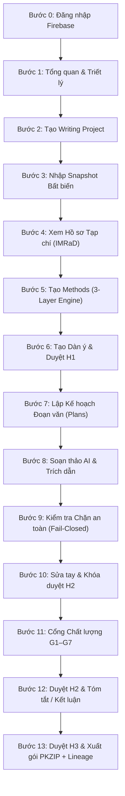

# Kịch bản Kiểm thử Giao diện Người dùng E2E (UI End-to-End Test Scenario)
## Hệ thống Hỗ trợ Viết Bản thảo Tổng quan Tài liệu Khoa học (SLR AI Writing Engine)

> [!NOTE]
> **Mục đích tài liệu:** Hướng dẫn chi tiết kịch bản kiểm thử trực quan trên giao diện người dùng (Web UI) từ đầu đến cuối (End-to-End Pipeline). Kịch bản này phản ánh chính xác 100% luồng tự động hóa mà Playwright script và bộ kiểm thử E2E đã thực thi thành công.

---

## 1. Thông tin Môi trường & Chuẩn bị Kiểm thử

### 1.1. Địa chỉ dịch vụ & Cổng mạng
| Dịch vụ | Địa chỉ URL / Port | Vai trò | Trạng thái yêu cầu |
| :--- | :--- | :--- | :--- |
| **Frontend Web UI** | `http://localhost:5180` (hoặc `http://localhost:5173`) | Giao diện viết bài, duyệt bài & xuất bản | Sẵn sàng (Healthy) |
| **Writing Backend API** | `http://localhost:5120` (hoặc `http://localhost:5100`) | Động cơ kiểm chứng, drafting, quản lý phiên bản | Sẵn sàng (Healthy) |
| **Firebase Auth Emulator** | `http://localhost:9099` | Xác thực người dùng cục bộ | Sẵn sàng (Healthy) |
| **SLR Upstream (Demo / Mock)** | `http://localhost:5001` (hoặc `http://localhost:5000`) | Cung cấp run và artifact A1–A10 đã duyệt từ SLR | Sẵn sàng (Healthy) |
| **PostgreSQL Database** | `localhost:5433` (Docker: `slr-writing-postgres`) | Cơ sở dữ liệu append-only provenance | Sẵn sàng (Healthy) |

### 1.2. Tài khoản kiểm thử (Test Account)
- **Email:** `demo@example.com`
- **Mật khẩu:** `Demo@12345`
*(Do kết nối với Firebase Auth Emulator cục bộ, token được cấp phát tức thì mà không phụ thuộc vào internet).*

---

## 2. Luồng Kiểm thử Từng bước (Step-by-Step Test Walkthrough)

---

### Bước 0: Xác thực & Đăng nhập (Authentication Gate)
- **Mục tiêu:** Kiểm tra cơ chế bảo vệ phiên đăng nhập: mọi trang đều chuyển hướng về đăng nhập nếu chưa có token.
- **Đường dẫn (URL):** Truy cập `http://localhost:5180/`
- **Hành động:**
  1. Màn hình tự động điều hướng sang trang `/login`.
  2. Nhập Email: `demo@example.com`.
  3. Nhập Password: `Demo@12345`.
  4. Bấm nút **"Đăng nhập"**.
- **Tiêu chuẩn chấp thuận (Expected Results):**
  - Đăng nhập thành công, token được lưu vào session của trình duyệt.
  - Tự động chuyển hướng vào trang Tổng quan dự án (`/`).

---

### Bước 1: Tổng quan Hệ thống & Triết lý Cốt lõi (Overview)
- **Mục tiêu:** Hiểu rõ các nguyên tắc nền tảng của hệ thống trước khi thao tác.
- **Đường dẫn (URL):** `http://localhost:5180/`
- **Quan sát:**
  - Thông điệp bảo vệ đồ án nổi bật: **"AI chỉ viết văn, không được đổi số liệu khoa học."**
  - Hiển thị đầy đủ sơ đồ 8 bước luồng xử lý và các chốt chặn con người H1, H2, H3.

---

### Bước 2: Tạo Project Viết bài & Liên kết Project SLR (Projects)
- **Mục tiêu:** Khởi tạo không gian viết bài mới, liên kết với ID của một project SLR tương ứng.
- **Đường dẫn (URL):** Bấm menu bên trái **"Dự án"** hoặc truy cập `/import?newProject=1`.
- **Hành động:**
  1. Nhập **Tên writing project:** `Demo SLR Đồ Án 2026`.
  2. Nhập **ID project SLR liên kết:** `proj_slr_demo_01`.
  3. Bấm nút **"Tạo và tiếp tục"**.
- **Tiêu chuẩn chấp thuận (Expected Results):**
  - Hệ thống tạo mới một record `Project` trong PostgreSQL.
  - Hiển thị thông báo tạo thành công và chuyển ngay sang giao diện chọn Snapshot.

---

### Bước 3: Nhập Snapshot Bất biến & Kiểm định Độ sẵn sàng (Snapshot & Readiness)
- **Mục tiêu:** Đảm bảo chỉ những run đã được thẩm định đầy đủ từ hệ thống SLR mới được nhập làm căn cứ viết bài.
- **Đường dẫn (URL):** `/import` hoặc `/snapshots`
- **Hành động:**
  1. Quan sát danh sách các Run xuất hiện trong bảng chọn (`SlrRunPicker`).
  2. Bấm chọn run: `run-20261030101014-gbekjc`.
  3. Quan sát các huy hiệu (badges) của 4 artifact cốt lõi:
     - `A1: approved` (Bảng trích xuất dữ liệu)
     - `A2: approved` (Đặc điểm nghiên cứu)
     - `A7: approved` (Bằng chứng tổng hợp)
     - `A10: approved` (Giao thức tổng quan)
  4. Bấm nút **"Import snapshot"** (hoặc "Nhập snapshot").
- **Tiêu chuẩn chấp thuận (Expected Results):**
  - Backend thực hiện tải toàn bộ run, frozen corpus, và các phụ lục PRISMA flow.
  - Bộ kiểm định `assessReadiness` chạy và đánh giá trạng thái đạt **`READY`** (không có lỗi blocking).
  - Snapshot được gán một mã băm bất biến `integrityHash` (ví dụ: `sha256:7056...`).

---

### Bước 4: Xem Hồ sơ Tạp chí IMRaD (Journal Profiles)
- **Mục tiêu:** Xem cấu trúc chuẩn hóa của bài báo khoa học theo cấu trúc IMRaD.
- **Đường dẫn (URL):** Bấm menu **"Hồ sơ tạp chí"** (`/journal-profiles`).
- **Quan sát:**
  - Khung cấu trúc bài báo: *Mở đầu (Introduction)*, *Phương pháp (Methods)*, *Kết quả (Results)*, *Thảo luận (Discussion)*.
  - Huy hiệu cảnh báo rõ ràng: **"Chưa xác minh với tạp chí nào" (Unverified)** — nhằm bảo đảm không gây ngộ nhận rằng bài báo đã được một tạp chí cụ thể bảo trợ form mẫu.

---

### Bước 5: Sinh phần Phương pháp bằng Động cơ 3 Lớp (Methods / PRISMA - M2)
- **Mục tiêu:** Khẳng định nguyên tắc **"Không dùng AI để bịa số liệu PRISMA"**. Phần Phương pháp phải được sinh 100% bằng mẫu tất định từ snapshot facts.
- **Đường dẫn (URL):** Bấm menu **"Phương pháp (PRISMA)"** (`/methods`).
- **Hành động:**
  1. Bấm nút **"Tạo Methods"** (hoặc "Tạo lại").
  2. Chờ 1–2 giây để động cơ biên dịch.
- **Tiêu chuẩn chấp thuận (Expected Results):**
  - Hiển thị văn bản Markdown hoàn chỉnh mô tả quy trình tìm kiếm, sàng lọc và số liệu nghiên cứu đưa vào (ví dụ: 6 nghiên cứu, 30 findings).
  - Trình tạo ghi rõ: `methods-template@1` (không sử dụng LLM token nào).
  - Xuất hiện Content Hash chứng minh văn bản xuất phát nguyên gốc từ số liệu snapshot.

---

### Bước 6: Sinh Dàn ý Bài báo & Phê duyệt Con người H1 (Outline & H1 Approval - M5)
- **Mục tiêu:** Định hình cấu trúc phân bổ các câu hỏi nghiên cứu (RQs) và để người phụ trách (OWNER) phê duyệt định hướng trước khi viết văn.
- **Đường dẫn (URL):** Bấm menu **"Dàn ý / H1"** (`/outline`).
- **Hành động:**
  1. Bấm nút **"Tạo dàn ý từ snapshot"**.
  2. Quan sát bảng kiểm soát độ phủ câu hỏi nghiên cứu (Research Question Coverage): cả 3 RQ đều được phân bổ vào các tiểu mục.
  3. Bấm nút **"Duyệt dàn ý (H1)"** (với tư cách OWNER).
- **Tiêu chuẩn chấp thuận (Expected Results):**
  - Trạng thái dàn ý chuyển thành **`ĐÃ DUYỆT (H1 APPROVED)`**.
  - Sự kiện phê duyệt được ghi bất biến vào bảng kiểm toán (Provenance Event).

---

### Bước 7: Lập Kế hoạch Đoạn văn & Gắn Bằng chứng (Paragraph Plans - M6)
- **Mục tiêu:** Phân rã từng phần của bài viết thành các đoạn văn cụ thể, gán chặt bằng chứng tối thiểu cho từng đoạn để AI không thể "chém gió".
- **Đường dẫn (URL):** Bấm menu **"Soạn thảo & H2"** $\rightarrow$ Tab **"Kế hoạch đoạn"** (`/drafting#paragraph-plans`).
- **Hành động:**
  1. Bấm nút **"Tạo kế hoạch đoạn văn"**.
  2. Quan sát danh sách các paragraph plans được sinh ra:
     - Đoạn `P-claim-01`: gắn bằng chứng `[E-01]` (chính xác dòng, trang, đoạn trích từ bài báo nguồn).
     - Đoạn `P-claim-02`: gắn bằng chứng `[E-02]`.
- **Tiêu chuẩn chấp thuận (Expected Results):**
  - Hệ thống hiển thị đầy đủ tổng số đoạn (ví dụ: 12 đoạn) và số đoạn đã sẵn sàng để viết (Ready to Draft).

---

### Bước 8: Soạn thảo Văn bản bằng AI & Đối soát Trích dẫn (Drafting & Registry Citation - M7)
- **Mục tiêu:** AI chỉ biên tập văn phong khoa học từ đúng gói bằng chứng tối thiểu đã chỉ định.
- **Đường dẫn (URL):** Tab **"Kết quả"** trong trang Soạn thảo (`/drafting`).
- **Hành động:**
  1. Bấm nút **"Viết từ kế hoạch"** (hoặc "Soạn section bằng AI").
  2. Chờ hệ thống gọi mô hình và đối soát schema Zod.
  3. Khi văn bản xuất hiện, tìm mã trích dẫn **`[E-01]`** hoặc **`[E-02]`** trong văn bản và bấm chuột vào đó.
  4. Lặp lại thao tác soạn thảo cho tab **"Thảo luận"** và **"Mở đầu"**.
- **Tiêu chuẩn chấp thuận (Expected Results):**
  - Văn bản tiếng Anh học thuật được tạo ra có viện dẫn chính xác `[E-01]`, `[E-02]`.
  - Khi bấm vào mã trích dẫn, một popup kiểm tra xuất hiện, xác nhận mã này khớp 100% với thực thể trong Reference Registry của Snapshot gốc. Không có hiện tượng bịa citation (hallucinated citation).

---

### Bước 9: Kiểm tra Cơ chế Chặn An toàn (Fail-Closed Safety Enforcement)
- **Mục tiêu:** Kiểm tra nguyên tắc Fail-Closed: Tuyệt đối không cho phép xuất bản bài báo nếu chưa thỏa mãn toàn bộ điều kiện chất lượng và phê duyệt.
- **Đường dẫn (URL):** Bấm menu **"Xuất bản & H3"** (`/export`).
- **Quan sát:**
  - Hệ thống hiển thị hộp cảnh báo màu vàng/đỏ: **"Chưa đủ điều kiện để xuất bản"**.
  - Liệt kê chi tiết lý do:
    - *Chưa duyệt H2 cho các section nháp.*
    - *Chưa chạy báo cáo kiểm chứng chất lượng hiện hành.*
  - Nút **"Cho phép duyệt H3"** và nút **"Tạo gói nộp bài"** hoàn toàn bị vô hiệu hóa (disabled).

---

### Bước 10: Thử nghiệm Sửa tay & Tự động Khóa Duyệt H2 (Manual Edit & Invalidation)
- **Mục tiêu:** Chứng minh tính toàn vẹn: Bất kỳ sự can thiệp thủ công nào bằng tay của con người vào văn bản cũng làm phát sinh phiên bản mới và hủy bỏ trạng thái duyệt cũ.
- **Đường dẫn (URL):** Quay lại trang Soạn thảo (`/drafting`), Tab **"Kết quả"**.
- **Hành động:**
  1. Bấm nút **"Sửa tay"** (Edit prose).
  2. Trình soạn thảo văn bản mở ra. Nhập thêm câu: `This is an audited manual edit for scientific integrity verification.`
  3. Bấm **"Lưu bản sửa"**.
- **Tiêu chuẩn chấp thuận (Expected Results):**
  - Phiên bản section tăng lên (ví dụ: từ `v1` lên `v2`).
  - Nút **"Duyệt H2"** ngay lập tức bị **KHÓA LẠI (Disabled)**.
  - Báo cáo kiểm chứng bị đánh dấu là đã cũ (STALE) và yêu cầu bắt buộc phải kiểm chứng lại.

---

### Bước 11: Động cơ Kiểm chứng 7 Cổng Chất lượng (Quality Gates G1–G7 - M8)
- **Mục tiêu:** Đánh giá toán học & ngữ nghĩa toàn bộ văn bản bản thảo trước 7 cổng kiểm định khắt khe.
- **Đường dẫn (URL):** Bấm menu **"Cổng chất lượng"** (`/verification`).
- **Hành động:**
  1. Bấm nút **"Chạy kiểm chứng"** (hoặc "Chạy lại các cổng").
  2. Theo dõi tiến trình đánh giá lần lượt 7 cổng.
- **Tiêu chuẩn chấp thuận (Expected Results):**
  - Cả 7/7 cổng đều hiển thị trạng thái **`ĐẠT (PASS)`**:
    - **G1 (Trích dẫn):** 100% trích dẫn phân giải đúng thực thể trong snapshot registry.
    - **G2 (Trích nguyên văn):** Mã băm câu trích khớp tuyệt đối với tài liệu nguồn.
    - **G3 (Lưu đồ PRISMA):** Số lượng 6 nghiên cứu khớp hoàn toàn với corpus facts.
    - **G4 (Số liệu thực nghiệm):** Mọi số liệu trong văn bản đều được neo nguồn gốc.
    - **G5 (Suy luận ngữ nghĩa NLI):** Bằng chứng chứng minh cho tuyên bố, không mâu thuẫn (Entailment).
    - **G6 (Cường độ luận điểm):** Tuân thủ rào đón khoa học (hedging).
    - **G7 (Độ phủ câu hỏi):** Đủ 3/3 RQs được giải quyết.
  - Tổng thể trạng thái báo cáo: **`PASSED`** (0 Blocking issues, 0 Warnings).

---

### Bước 12: Duyệt H2 Thân bài & Soạn Tóm tắt / Kết luận (H2 Approvals & Synthesis)
- **Mục tiêu:** Duyệt nội dung các phần cốt lõi và sau đó mới cho phép sinh phần Tóm tắt/Kết luận từ các phần đã duyệt.
- **Đường dẫn (URL):** Trang Soạn thảo (`/drafting`).
- **Hành động:**
  1. Bấm **"Duyệt H2"** cho tab **"Kết quả"**.
  2. Bấm **"Duyệt H2"** cho tab **"Thảo luận"**.
  3. Bấm **"Duyệt H2"** cho tab **"Mở đầu"**.
  4. Bấm **"Duyệt H2"** cho tab **"Phương pháp"**.
  5. Chuyển sang tab **"Tóm tắt" (Abstract)** $\rightarrow$ Bấm **"Viết từ các phần đã duyệt"** $\rightarrow$ Bấm **"Duyệt H2"**.
  6. Chuyển sang tab **"Kết luận" (Conclusion)** $\rightarrow$ Bấm **"Viết từ các phần đã duyệt"** $\rightarrow$ Bấm **"Duyệt H2"**.
  7. Quay lại trang **Cổng chất lượng** (`/verification`) $\rightarrow$ Bấm **"Chạy lại các cổng"** để báo cáo cập nhật toàn diện bài báo.
- **Tiêu chuẩn chấp thuận (Expected Results):**
  - Tất cả các section đều đạt trạng thái `ĐÃ DUYỆT H2`.
  - Abstract và Conclusion chỉ tóm lược từ nội dung đã duyệt H2, không phát sinh trích dẫn hay số liệu lạ.

---

### Bước 13: Phê duyệt Con người Tối cao H3 & Xuất Gói Nộp Bài PKZIP (Export Package & Lineage - M9)
- **Mục tiêu:** OWNER thực hiện phê duyệt cuối cùng để mở khóa xuất bản gói tài liệu khoa học chuẩn mực và kiểm tra truy vết ngược nguồn gốc.
- **Đường dẫn (URL):** Bấm menu **"Xuất bản & H3"** (`/export`).
- **Hành động:**
  1. Kiểm tra danh sách điều kiện: Tất cả các dòng đều có dấu tích xanh (G1–G7 passed, H1 approved, All H2 approved, Báo cáo kiểm chứng hiện hành).
  2. Bấm nút **"Cho phép duyệt H3"** $\rightarrow$ Hộp xác nhận mở ra $\rightarrow$ Bấm **"Cho phép và duyệt H3"**.
  3. Khi trạng thái chuyển thành **`ĐÃ DUYỆT H3 (APPROVED)`**, bấm nút **"Tạo gói v1"**.
  4. Quan sát danh mục 7 tệp tin trong gói nộp bài xuất hiện trên màn hình:
     - `manuscript.md`: Toàn văn bài báo khoa học chuẩn IMRaD.
     - `citation-manifest.json`: Bảng đối chiếu trích dẫn khép kín.
     - `verification-report.json`: Báo cáo 7 cổng kiểm định chất lượng.
     - `ai-disclosure.md`: Bản minh bạch việc sử dụng AI theo thông lệ COPE/ICMJE.
     - `revision-history.json`: Lịch sử các phiên bản sửa đổi và người phê duyệt.
     - `evidence-lineage.json`: Phả hệ truy vết bằng chứng.
     - `audit-metadata.json`: Chữ ký băm xác thực gói.
  5. Bấm nút **"Truy vết ngược nguồn bằng chứng"** (Evidence Lineage Explorer).
- **Tiêu chuẩn chấp thuận (Expected Results):**
  - Gói ZIP tải về máy hoàn chỉnh, giải nén đúng 7 tệp tin không bị lỗi cấu trúc.
  - Sơ đồ truy vết (Lineage) hiển thị rõ ràng: Bấm vào bất kỳ câu nào trong bản thảo sẽ truy vết ngược chính xác về: Đoạn trích dẫn $\rightarrow$ Trang / Đoạn trong file PDF gốc $\rightarrow$ Tên bài báo $\rightarrow$ Năm xuất bản $\rightarrow$ DOI.

---

## 3. Bảng Tổng kết Tiêu chí Đánh giá Kiểm thử (Pass/Fail Criteria)

| STT | Bước kiểm thử | Điểm chốt chặn cần đạt | Kết quả mong đợi |
| :---: | :--- | :--- | :---: |
| 1 | Xác thực | Chặn truy cập trái phép khi chưa đăng nhập | **PASS** |
| 2 | Quản lý Project | Khởi tạo và liên kết chính xác SLR Project ID | **PASS** |
| 3 | Nhập Snapshot | Tính toán băm toàn vẹn `integrityHash` và kiểm tra readiness | **PASS** |
| 4 | Hồ sơ Tạp chí | Hiển thị IMRaD kèm nhãn "Chưa xác minh" | **PASS** |
| 5 | Phương pháp (M2) | Sinh từ mẫu cố định 3 lớp, **0 LLM token**, số liệu PRISMA chuẩn | **PASS** |
| 6 | Dàn ý & H1 | Đủ độ phủ 3/3 RQs, OWNER duyệt H1 ghi nhận vào sổ nhật ký | **PASS** |
| 7 | Kế hoạch đoạn | Phân bổ evidence pack tối thiểu vào từng đoạn | **PASS** |
| 8 | Soạn thảo & H2 | AI chỉ viết từ bằng chứng, trích dẫn registry-only `[E-01]` | **PASS** |
| 9 | Chặn an toàn | Khóa nút xuất bản khi chưa đủ điều kiện (Fail-closed) | **PASS** |
| 10 | Sửa tay | Phát sinh phiên bản mới, tự động khóa nút H2 | **PASS** |
| 11 | Cổng chất lượng | Vượt qua 7/7 cổng G1–G7 với trạng thái `PASSED` | **PASS** |
| 12 | Abstract/Conclusion | Chỉ sinh từ các phần đã duyệt H2, không thêm dữ kiện mới | **PASS** |
| 13 | Duyệt H3 & Xuất bài | Tạo gói PKZIP 7 tệp và truy vết phả hệ Lineage chuẩn xác | **PASS** |
